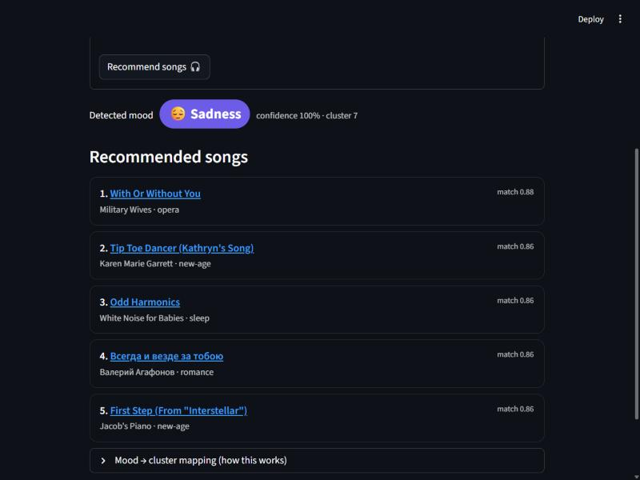
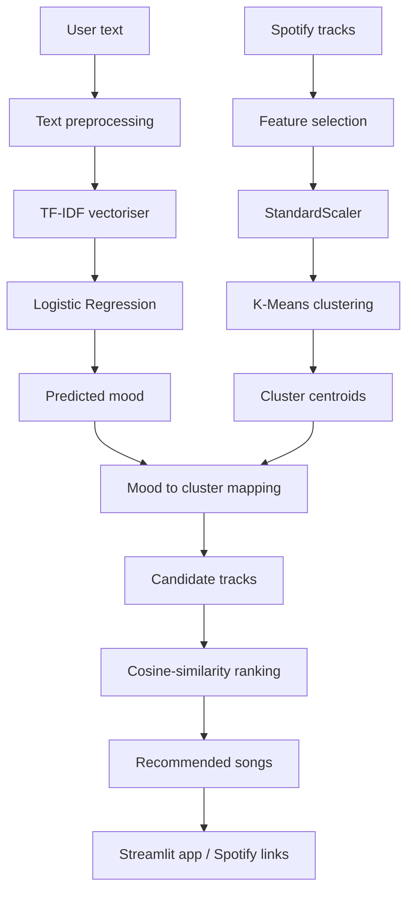
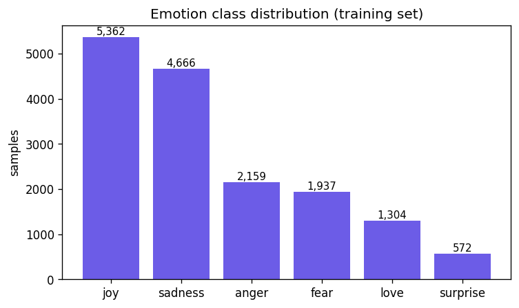
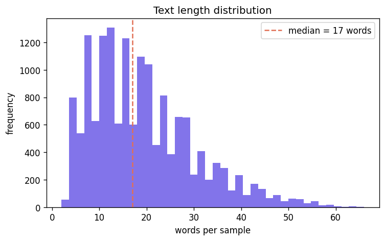
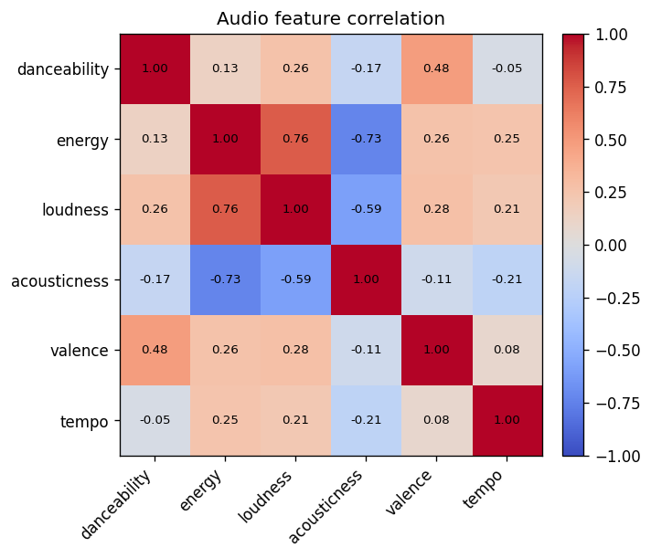
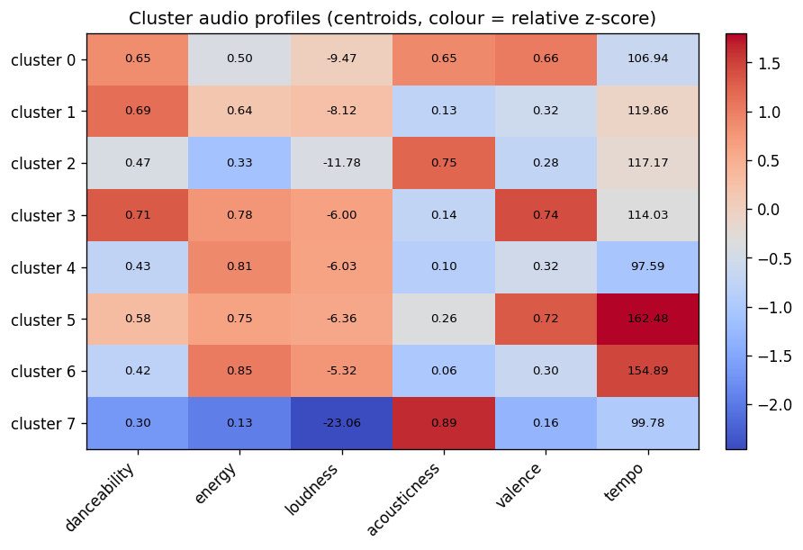
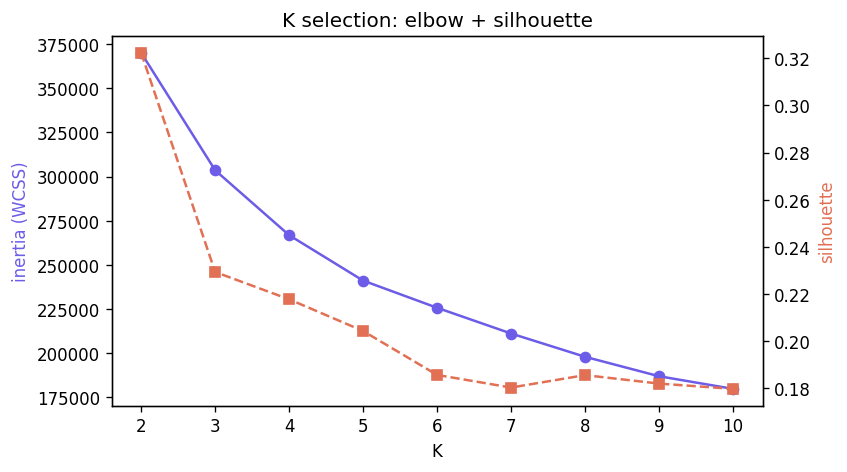

<div align="center">

# 🎵 Music Recommendation System

**A mood-aware music recommender that combines NLP-based emotion classification with unsupervised clustering of Spotify audio features.**

[](https://www.python.org/)
[](https://scikit-learn.org/)
[](https://streamlit.io/)
[](tests/)
[](LICENSE)

</div>

You type how you feel in plain language. The system detects your emotion, maps it to a musically coherent group of tracks, and ranks the best matches for that mood.

<div align="center">
  
</div>

---

## Table of Contents

- [Overview](#overview)
- [Key Features](#key-features)
- [System Architecture](#system-architecture)
- [How It Works](#how-it-works)
- [Datasets](#datasets)
- [Exploratory Data Analysis](#exploratory-data-analysis)
- [Mood Classification](#mood-classification)
- [Music Clustering](#music-clustering)
- [Recommendation Engine](#recommendation-engine)
- [Results](#results)
- [Project Structure](#project-structure)
- [Tech Stack](#tech-stack)
- [Installation](#installation)
- [Environment Variables](#environment-variables)
- [Running the Project](#running-the-project)
- [Example Usage](#example-usage)
- [Testing](#testing)
- [Limitations](#limitations)
- [Future Improvements](#future-improvements)
- [License](#license)
- [Author](#author)

---

## Overview

**Problem.** Picking music that fits your current emotional state is a manual chore. Mood lives in natural language ("I've had a rough day"), while a track's "feel" lives in numeric audio features (valence, energy, tempo). The two do not connect out of the box.

**Solution.** This project bridges that gap with two complementary machine-learning models:

1. **Supervised NLP (mood detection).** Free-form text is vectorised with **TF-IDF** and classified into one of six emotions with **Logistic Regression**.
2. **Unsupervised clustering (track organisation).** Spotify audio features are standardised and grouped with **K-Means** into musically coherent clusters.

A transparent, **data-driven mood-to-cluster mapping** connects the two, and candidate tracks inside the selected cluster are ranked by **cosine similarity** to the target mood profile. The result is a recommendation that is explainable end to end.

---

## Key Features

- 🎭 **Mood detection** from free-form text
- 🧠 **NLP emotion classification** (6 classes: joy, love, sadness, anger, fear, surprise)
- 📊 **TF-IDF feature engineering** (unigrams + bigrams, fitted on training data only)
- 🤖 **Logistic Regression** with balanced class weights
- 🎵 **Audio-feature analysis** of 89k+ Spotify tracks
- 🔵 **K-Means clustering** with standardised features and evidence-based K selection
- 🎯 **Data-driven mood-to-cluster mapping** (no hard-coded cluster ids)
- 📐 **Cosine-similarity ranking** within the selected cluster
- 🔗 **Optional Spotify API enrichment** (links, album art, previews)
- 🖥️ **Interactive Streamlit app**
- ✅ **18 passing unit tests**

---

## System Architecture



---

## How It Works

### Stage 1 — Text preprocessing
Lower-case, strip URLs and `@mentions`, drop non-letter characters, collapse whitespace. Tokenisation and stop-word removal are handled by the vectoriser. Lemmatisation is deliberately omitted (it collapsed distinct feeling words with no measurable gain on these short sentences).

### Stage 2 — TF-IDF
`TF-IDF(t, d) = TF(t, d) × IDF(t)`. It up-weights words that are distinctive to a sentence and down-weights terms that are common across the whole corpus, which emphasises the emotional vocabulary. Configuration: unigrams + bigrams, `max_features=20000`, English stop-words, sublinear TF. **The vectoriser is fitted on the training split only** to prevent leakage, then persisted.

### Stage 3 — Logistic Regression
A linear model over the sparse TF-IDF space: `z = wᵀx + b`, `σ(z) = 1 / (1 + e⁻ᶻ)`, multinomial for the six classes. Chosen because it is a strong, interpretable, computationally cheap baseline for high-dimensional sparse text. `class_weight="balanced"` offsets the imbalance (joy and sadness dominate; surprise is rare).

### Stage 4 — Audio-feature preprocessing
Six features are selected (`danceability`, `energy`, `loudness`, `acousticness`, `valence`, `tempo`). They live on very different scales (tempo in BPM, valence in 0–1, loudness in dB), so they are **standardised** with `z = (x − μ) / σ` before clustering. The scaler is persisted and reused at inference.

### Stage 5 — K-Means
K-Means minimises within-cluster variance using Euclidean distance (hence the scaling). K is chosen from evidence (elbow + silhouette), not arbitrarily. See [Music Clustering](#music-clustering).

### Stage 6 — Recommendation
`Predicted mood → best-matching cluster → candidate tracks → cosine-similarity ranking → top-N songs`. The ranking uses `cos(θ) = (a · b) / (‖a‖ ‖b‖)` between each track's standardised feature vector and the target mood profile.

---

## Datasets

| Dataset | Purpose | Size | Key fields |
|---|---|---|---|
| [dair-ai/emotion](https://huggingface.co/datasets/dair-ai/emotion) | Mood classification | 16k / 2k / 2k (train/val/test) | `text`, `emotion` |
| [maharshipandya/spotify-tracks-dataset](https://huggingface.co/datasets/maharshipandya/spotify-tracks-dataset) | Track clustering | 114k rows → 89,583 after cleaning | audio features + track metadata |

Raw data is downloaded on demand (`python scripts/prepare_data.py`) and is git-ignored. See [`data/README.md`](data/README.md) for details.

---

## Exploratory Data Analysis

| Emotion class balance | Text length |
|---|---|
|  |  |

- The emotion dataset is **imbalanced**: joy (~5.4k) and sadness (~4.7k) dominate, surprise (~0.6k) is scarce. This is why the classifier uses balanced class weights and macro-F1 is reported alongside accuracy.
- Most texts are short (median ~17 words), which suits a TF-IDF + linear-model approach.

| Audio-feature correlation | Cluster audio profiles |
|---|---|
|  |  |

- `energy` and `loudness` are strongly correlated, and both correlate negatively with `acousticness`, confirming the need for scaling before distance-based clustering.

---

## Mood Classification

Metrics below are computed on the **held-out 2,000-sample test split** by actually running the trained model (`scripts/train_mood.py`).

| Metric | Score |
|---|---:|
| Accuracy | **0.899** |
| Macro Precision | 0.845 |
| Macro Recall | 0.891 |
| Macro F1 | **0.865** |
| Weighted F1 | 0.901 |

**Per-class F1:** sadness 0.94 · joy 0.92 · anger 0.89 · fear 0.87 · love 0.80 · surprise 0.77.

Macro-F1 matters here because the classes are imbalanced: it averages per-class F1 equally, so strong overall accuracy cannot hide weak performance on the rare classes (love, surprise). The full per-class report and confusion matrix are saved to `models/mood_classifier/metadata.json`.

---

## Music Clustering

K was scanned over 2–10 and evaluated with inertia (elbow) and silhouette:



Silhouette peaks at **K = 2**, but that only splits tracks into "loud" vs. "quiet", which is too coarse to separate six moods. Inertia flattens past the elbow around K ≈ 6–8, and K = 8 is a local silhouette bump (0.185) past the elbow. **K = 8** was selected as the balance between cluster quality and enough granularity for mood-aware recommendation.

Cluster centroids (original units) and the interpretation derived from them:

| Cluster | Dance | Energy | Loudness | Acoustic | Valence | Tempo | Interpretation |
|:---:|---:|---:|---:|---:|---:|---:|---|
| 0 | 0.65 | 0.50 | -9.5 | 0.65 | 0.66 | 107 | Warm, acoustic, feel-good |
| 1 | 0.69 | 0.64 | -8.1 | 0.13 | 0.32 | 120 | Moody electronic groove |
| 2 | 0.47 | 0.33 | -11.8 | 0.75 | 0.28 | 117 | Mellow downtempo acoustic |
| 3 | 0.71 | 0.78 | -6.0 | 0.14 | **0.74** | 114 | Upbeat, happy, danceable |
| 4 | 0.43 | 0.81 | -6.0 | 0.10 | 0.32 | 98 | Heavy, intense, low-valence |
| 5 | 0.58 | 0.75 | -6.4 | 0.26 | 0.72 | **162** | High-tempo, euphoric |
| 6 | 0.42 | **0.85** | -5.3 | 0.06 | 0.30 | 155 | Aggressive, high-energy |
| 7 | 0.30 | **0.13** | **-23** | **0.89** | **0.16** | 100 | Quiet, ambient, somber |

---

## Recommendation Engine

Each emotion has a **preference vector** over the audio features (e.g. joy favours high valence / energy / danceability; sadness favours low valence / energy and high acousticness). The mapping is then **derived from the data**: each cluster centroid is scored against every mood's preferences, and the mood attaches to the best-matching cluster. Nothing is pinned to a fixed cluster id.

The mapping produced by the trained K = 8 model:

| Mood | Cluster | Character of that cluster |
|---|:---:|---|
| joy | 3 | Upbeat, happy, danceable |
| love | 3 | Upbeat, happy, danceable |
| sadness | 7 | Quiet, ambient, somber |
| anger | 6 | Aggressive, high-energy |
| fear | 7 | Quiet, ambient, somber |
| surprise | 5 | High-tempo, euphoric |

Within the chosen cluster, tracks are ranked by cosine similarity between their standardised feature vector and the mood preference vector, and duplicates (same title + artist) are removed before returning the top-N.

---

## Results

A real run through the pipeline (`"I am feeling low and heartbroken tonight, everything feels heavy and hopeless."`):

```
Detected mood : sadness (confidence 100%, cluster 7)
Recommendations:
  1. With Or Without You            - Military Wives        [opera]
  2. Tip Toe Dancer (Kathryn's Song)- Karen Marie Garrett   [new-age]
  3. Odd Harmonics                  - White Noise for Babies[sleep]
  4. Всегда и везде за тобою         - Валерий Агафонов      [romance]
  5. First Step (From "Interstellar")- Jacob's Piano         [new-age]
```

For `"I'm furious and want to scream"` the system detects **anger** and returns punk-rock, hardcore and metalcore tracks from the high-energy cluster. Recommendations are generated live by the model, not pre-written.

---

## Project Structure

```
MRS/
├── app/
│   └── app.py                      # Streamlit UI
├── assets/                         # EDA figures + demo screenshot
├── data/
│   ├── raw/                        # downloaded datasets (git-ignored)
│   ├── processed/
│   └── README.md
├── models/
│   ├── mood_classifier/            # tfidf + logreg + metadata
│   └── music_clusterer/            # scaler + kmeans + clustered tracks + metadata
├── scripts/
│   ├── prepare_data.py             # download datasets
│   ├── train_mood.py               # train + evaluate mood classifier
│   ├── train_clusters.py           # K selection + train clusterer
│   └── eda.py                      # generate EDA figures
├── src/
│   ├── preprocessing/text_preprocessor.py
│   ├── models/mood_classifier.py
│   ├── models/music_clusterer.py
│   ├── recommendation/recommender.py
│   ├── spotify/spotify_client.py
│   └── utils/config.py
├── tests/                          # pytest suite (18 tests)
├── .env.example
├── .gitignore
├── requirements.txt
├── LICENSE
└── README.md
```

---

## Tech Stack

**Language:** Python 3.11
**ML / data:** scikit-learn, NumPy, pandas, SciPy, joblib
**Visualisation:** matplotlib
**App:** Streamlit
**Integrations:** Spotipy (optional), python-dotenv
**Testing:** pytest

---

## Installation

```bash
git clone https://github.com/PratyakshDwivedi/MRS.git
cd MRS

python -m venv venv
```

Activate the virtual environment:

```bash
# Windows
venv\Scripts\activate

# macOS / Linux
source venv/bin/activate
```

Install dependencies:

```bash
pip install -r requirements.txt
```

The repository ships with the trained model artifacts, so you can run the app immediately. To retrain from scratch, follow [Running the Project](#running-the-project).

---

## Environment Variables

Spotify credentials are **optional** (the recommender works fully offline). To enable live metadata enrichment, copy `.env.example` to `.env` and fill in your values from the [Spotify Developer Dashboard](https://developer.spotify.com/dashboard):

```env
SPOTIFY_CLIENT_ID=your_client_id
SPOTIFY_CLIENT_SECRET=your_client_secret
```

`.env` is git-ignored and must never be committed.

---

## Running the Project

### Run the app (uses the bundled models)

```bash
streamlit run app/app.py
```

### Retrain everything from scratch

```bash
python scripts/prepare_data.py      # 1. download datasets
python scripts/train_mood.py        # 2. train + evaluate mood classifier
python scripts/train_clusters.py    # 3. K selection + train clusterer (K=8 default)
python scripts/eda.py               # 4. (optional) regenerate EDA figures
```

Each training script prints real metrics and saves artifacts under `models/`.

---

## Example Usage

Programmatic use of the full pipeline:

```python
from src.recommendation import MusicRecommender

recommender = MusicRecommender.load()
result = recommender.recommend("I've had a rough day and want something mellow", n=5)

print(result.predicted_mood, result.confidence, result.cluster)
for rec in result.recommendations:
    print(f"{rec.track_name} - {rec.artists}  ({rec.similarity})")
```

Just the mood classifier:

```python
from src.models import MoodClassifier

clf = MoodClassifier.load()
pred = clf.predict("I'm so excited and happy right now!")
print(pred.mood, pred.confidence)   # e.g. joy 0.73
```

---

## Testing

```bash
pytest -q
```

The suite (18 tests) covers text preprocessing, mood classification (including untrained-model and empty-input guards), clustering (fit / assign / K evaluation on controlled blobs), and the end-to-end recommendation flow with edge cases. Tests that need trained artifacts skip gracefully if the models have not been trained yet.

---

## Limitations

- **TF-IDF is bag-of-words.** It captures distinctive words but not deeper semantics, sarcasm or negation ("not happy").
- **Six fixed emotions.** The dataset has no "calm/neutral" class, so relaxed text is forced into the nearest of the six labels.
- **Heuristic mood profiles.** The mapping is derived from real centroids, but the mood preference vectors themselves are hand-specified and could be learned.
- **K-Means assumes roughly spherical clusters** of similar size and is sensitive to the chosen K; audio features do not separate cleanly, so silhouette scores are modest.
- **Static catalogue.** Clusters are trained once on a fixed dataset and can become stale as music changes.
- **Dataset provenance.** Audio features come from the public Spotify tracks dataset, not a live user library.

---

## Future Improvements

- **NLP:** transformer-based emotion models (BERT / sentence embeddings) for context, negation and sarcasm.
- **Recommendation:** collaborative or hybrid filtering using listening history, likes, skips and replays.
- **Ranking:** learned, personalised ranking (learning-to-rank) instead of a fixed cosine target.
- **Mapping:** learn the mood-to-cluster relationship from feedback rather than hand-specified profiles.
- **Coverage:** add a neutral/calm class and richer multi-label moods.

---

## License

Released under the [MIT License](LICENSE).

---

## Author

**Pratyaksh Dwivedi**
GitHub: [@PratyakshDwivedi](https://github.com/PratyakshDwivedi)

> Built as an end-to-end machine-learning portfolio project: supervised NLP, unsupervised clustering, an explainable recommendation layer, a tested codebase and an interactive app.
